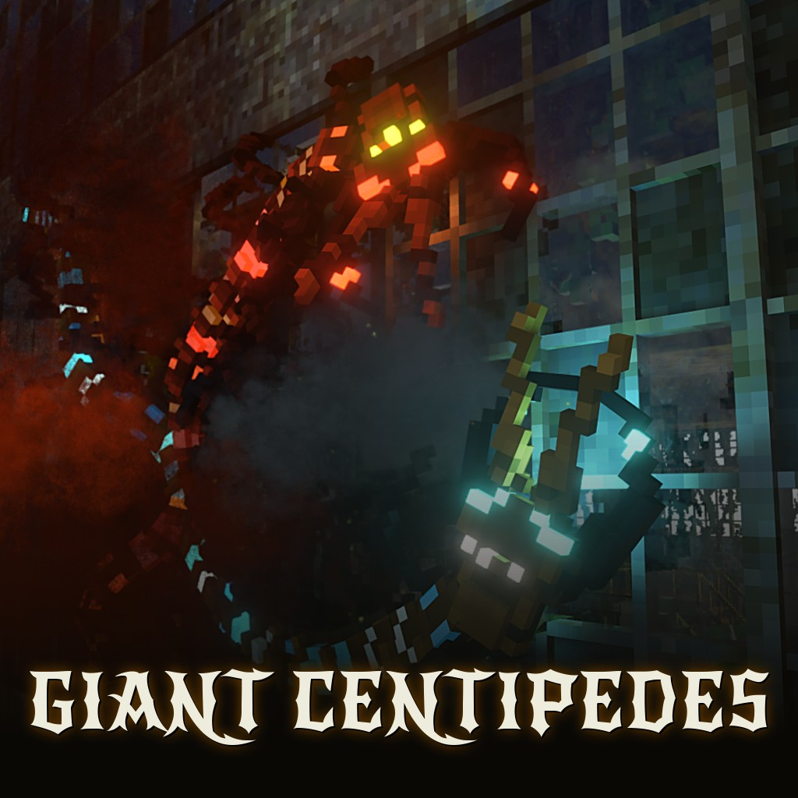

# Giant Centipedes

On the Steam Workshop: [Giant Centipedes](https://steamcommunity.com/sharedfiles/filedetails/?id=3838368186)

Four kinds of 12 m centipedes that crawl over floors, walls and ceilings, spin silk nests, drag their prey home and fight each other for ground: the acid-spitting Acidica (the Silkmaw), the fireproof Ignitus, the Clockwork Machina that hunts the others, and the Seismica that keeps growing and shakes the ground apart.

All the ideas in this mod and its four kinds come from **plasticroyal**, who built them on top of my [Abyssipede](https://steamcommunity.com/sharedfiles/filedetails/?id=3833158470) mod. I only optimized their code.

## The four kinds
- **Acidica (the Silkmaw)**: spits acid that eats through soft materials, builds a pale silk nest, drags you home and spins you into a cocoon. Fire alone can't kill it, but it runs for water when it burns.
- **Ignitus**: completely fireproof. It spits fire, its bite sets the other kinds alight (all but Machina), and its nest and cocoons are charred and won't burn. Acid is its weakness.
- **Clockwork Machina**: a machine that tracks the other kinds from up to 90 m away and hits them with an electric pulse. It leaves people alone until a player (or a Living Humans person) hurts it; then its lights turn red and it hunts you too. It builds no nest and takes no prisoners.
- **Seismica**: grows bigger and slower until it is twice its size after ten minutes. Its quake breaks the ground around it, throws loose objects and knocks you back, harder the bigger it gets; its spit is shards of rock.

## How they live
- They **stick to surfaces**: any floor, wall or ceiling, and they reach across gaps shorter than their own body. Water they swim across on the surface.
- They sense **light, movement and noise**: a lit flashlight in sight, running, gunfire. Up close they find you anyway.
- From a distance they **spit**. Close in, they stop dead, open their claws and lunge.
- Seized, you are **dragged to the nest**, losing health on the way. Hurting it enough makes it drop you.
- At the nest you are **spun into a cocoon**. You can look around but not move or fight, and you have 30 seconds. Another player cuts you free: walk up to the cocoon and press **E**. Freed, you have 5 seconds to run.
- Their attacks hurt for real: take enough and you die.

## Nests and the brood
- Acidica, Ignitus and Seismica each find a dark spot and **spin a nest**. Every visit home adds another ring of silk, up to three.
- One that survives long enough **lays eggs**. They hatch into juveniles of the same kind that stay close to the nest and bite.
- Juveniles **grow into adults** in ten minutes, leave, and build nests of their own. Up to ten centipedes are alive at once.
- Break the eggs and wreck the nest before that happens.

## Territory
- Acidica and Ignitus keep away from each other's ground, and fight to the death when they meet up close or near a nest.
- Machina hunts every other kind; they fight back once it comes close.
- A quake or a pulse never hurts its own kind.

## Fighting back
Shoot them (the head hurts most), blow them up, hit them with a sledge or any melee weapon, or **run them over** with a car. Nests break under bullets, blasts and cars. Fire sets the Acidica and Seismica alight; Ignitus and Machina don't burn.

## Spawning
The host places them from the spawn menu (Creatures > Silkmaw (Acidica), (Ignitus), (Clockwork Machina), (Seismica)). The marker stays where you put it down and the centipede comes out 7 seconds later, with a countdown over the marker. None appear on their own.

## With Living Humans
If the [Living Humans](https://steamcommunity.com/sharedfiles/filedetails/?id=3823255433) mod is on, the centipedes hunt its people too: they are dragged off and cocooned, and the juveniles feed on them. A friendly Machina counts as one of the humans.

## Multiplayer
The host turns it on under Global mods. Each player's game draws the bodies itself; the host runs the brains.

## For mod and map makers
Your own weapons can hurt any of them through two registry strings on the host: **silkmaw.hitpoints** (where their hit points are, written every tick as "id x y z radius head;") and **silkmaw.damage** (append "x y z amount;" per hit).

## Community

Join the [Discord community](https://discord.gg/gNpRewdkxf) to post bug reports and suggestions.

## Install

Subscribe on the [Steam Workshop](https://steamcommunity.com/sharedfiles/filedetails/?id=3838368186), or clone this repository into
`Documents/Teardown/mods/giant centipedes`. Enable it under **Global mods** (in multiplayer the host does).

## Credits

All the ideas and the four kinds are by **plasticroyal**, built on top of [Abyssipede](https://github.com/AgeOfAlgorithms/teardown-abyssipede-mod).
AgeOfAlgorithms optimized the code. MIT licence (see LICENSE).
